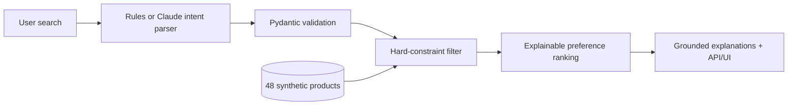

# Mosaic — Catalogue-Grounded AI Shopping Search

**Find the fit. Not just a result.**

Mosaic is a complete, testable **natural-language product-search prototype** built to demonstrate skills relevant to e-commerce search engineering: query understanding, structured intent extraction, hard-constraint filtering, interpretable ranking, backend APIs and reproducible evaluation.

> **Demo safety:** All products, names, prices, ratings and descriptions are fictional. This is a 48-item learning dataset, not a live store. The ranking formula is hand-designed, not a trained search model. There is no verified production relevance or conversion uplift.

## What works

- Search ordinary-language queries, e.g. `wireless over-ear headphones under $180 with ANC, ideally comfortable and foldable`.
- Convert queries into a typed intent with **hard constraints** (category, budget, required/excluded features, minimum battery life) and **soft preferences**.
- Filter products *before* scoring — no budget-violating recommendations.
- Rank eligible catalogue items with explicit preference, price-value and demo-rating components.
- Generate product explanations using only known catalogue attributes.
- Use a polished, responsive web UI or documented FastAPI endpoints.
- Run the application **entirely offline** for catalogue search (Google Fonts are optional visual decoration).
- Optionally enable **Claude intent extraction** with your own API key. The LLM cannot bypass the deterministic filter or invent product facts.
- Run unit tests, GitHub Actions CI and a hand-labelled **40-query diagnostic benchmark**.

## Start locally

Python 3.11 or newer is recommended.

```bash
python -m venv .venv
# macOS / Linux
source .venv/bin/activate
# Windows PowerShell: .venv\Scripts\Activate.ps1
pip install -e '.[dev]'
uvicorn mosaic.app:app --reload
```

Visit **http://127.0.0.1:8000** for the UI and **http://127.0.0.1:8000/docs** for the API reference.

### API example

```bash
curl -X POST http://127.0.0.1:8000/api/search \
  -H 'Content-Type: application/json' \
  -d '{"query":"headphones under $180 with ANC, ideally comfortable","top_k":3,"parser":"rules"}'
```

`POST /api/search` returns:

- Validated `intent` (category, budget, required/excluded features, preferences).
- `eligible_count`: number of items passing all hard constraints.
- `results`: ranked product records, evidence-grounded explanation and score breakdown.
- `suggestions` if nothing matches. No quiet relaxation of hard constraints.

Other endpoints: `GET /api/health`, `GET /api/catalogue`, interactive documentation at `/docs`.

## Optional Claude parser

```bash
pip install -e '.[llm]'
# set ANTHROPIC_API_KEY in your local environment (never commit it)
# optionally set MOSAIC_ANTHROPIC_MODEL
```

Select **Claude · optional API** in the UI. Without a configured key or optional dependency, the API returns an explicit configuration error rather than pretending an LLM call succeeded. Claude sees the search query only; the API still uses deterministic filtering, ranking, and source-grounded explanations. Optional remote LLM calls send query text to the provider; do not enter sensitive personal information.

## Reproducibility and testing

```bash
pytest -q
python -m evals.run_eval
ruff check mosaic tests evals
```

The 40-query benchmark evaluates **category extraction**, **budget extraction**, **hard-constraint violations**, **top-k category/budget validity** and **local runtime**. `evals/benchmark_queries.json` contains explicit reference labels. It does **not** test true relevance, conversions, personalisation or NDCG because that would require human-labelled product relevance judgments and a realistic dataset. Execution latencies will vary by computer.

## System design



See [ARCHITECTURE.md](docs/ARCHITECTURE.md) for detailed algorithmic choices, scoring weights, limitations and research directions.

## Engineering trade-offs

- **Why filter before ranking?** A low-priced product missing a mandatory feature must not outrank an eligible product.
- **Why distinguish soft and hard preferences?** Trade-offs should be explainable, never hidden.
- **Why return interpretable scores?** A reviewer should know exactly why an item appears above another.
- **Why no fake accuracy claim?** There is no production-trained ranker or independently labelled click data.
- **Why provide offline mode?** Recruiters and collaborators can reproduce the demo without API credentials or spending money.

## Portfolio discussion points

This project demonstrates Python/FastAPI engineering, typed contracts, ML-adjacent search reasoning, catalogue data modelling, constraints versus preferences, reproducible evaluation, and product thinking. A logical next step is a hybrid BM25/vector retrieval stage, human-labelled top-k relevance dataset, NDCG@k/MRR evaluation and learn-to-rank re-scoring.

**Status:** Standalone working prototype. Synthetic demonstration only; not a commercial recommendation service.
