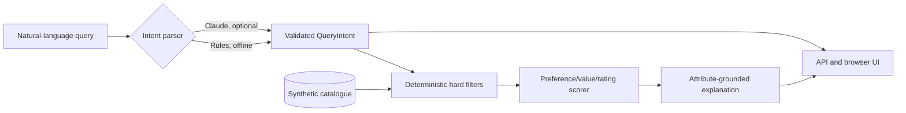

# Architecture and integrity boundaries

**Non-negotiable design choices**

1. The LLM, if enabled, only proposes structured intent. Pydantic validates it against an allowlist of categories/features.
2. The LLM has no authority to select or score products. A deterministic filter checks category, price ceiling, required/excluded features and battery threshold.
3. Ranking happens only within the eligible set. Results include matched preferences and components of the score.
4. Explanations use *only* catalogue values; no external review snippets, inferred product characteristics or unsupported claims.
5. A query with no valid products returns an empty set and transparent relaxation suggestions. It never silently breaks constraints.
6. Local product records and prices are fictional. No shopping links, real brands, external market prices or user tracking.

## Ranking formula

Given a valid candidate product:
- `preference_match`: fraction of explicitly soft-preferred features present, or 0.5 if no preferences are supplied.
- `price_value`: `max(0, 1 - price/ceiling)` where `ceiling` is the user budget or the highest catalogue price in the chosen category.
- `product_rating`: synthetic demonstration rating divided by five.

When preferences exist:

`score = 100 * (0.65 * preference_match + 0.15 * price_value + 0.20 * product_rating)`

Without preferences:

`score = 100 * (0.30 * price_value + 0.70 * product_rating)`

**These weights are illustrative, not ML-learned or calibrated to actual shopper behaviour.** A real search team would tune ranking against relevance judgments, click/conversion data, fairness, merchant goals and business constraints.

## Where the model belongs

The optional Claude parser can extract structured requests more flexibly than rules on unusual phrasing. Its output is a `QueryIntent`, never a freeform recommendation. API keys remain local environment variables. We do not claim that this demo implements model retraining, learning-to-rank, search indexes, vector embeddings or personalised recommendations.

## Risks and future engineering

- Missing categories and aliases cause intent-extraction errors.
- Hard-vs-soft intent is heuristic. A user could mean "wireless" as essential but not explicitly say "must".
- The tiny catalogue cannot demonstrate real recall at scale or long-tail ranking.
- Synthetic ratings cannot validate actual quality or conversion uplift.
- No persistent user accounts, personalised histories or real merchant inventories.

Next milestones: labelled hard/soft intents, annotation review, p95 latency load testing, real catalogue ingestion with permission, hybrid lexical/vector retrieval, graded relevance labels and NDCG/MRR, online A/B testing (if production-accessible), multilingual query parsing, and prompt-injection tests for the LLM parser.
